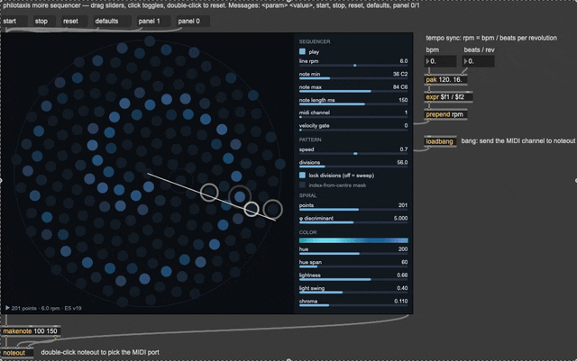

Prompted from [sousastep.quest](https://github.com/jbaylies/sousastep.quest/tree/gh-pages/public/shaders)'s shader, which was itself prompted from [SousaVFX](https://github.com/Sousastep/sousaVFX-teensy/tree/main/SousaVFX)'s teensy code, which I mostly figured out myself, initially, before ai got good.

# philotaxis moiré sequencer

A Max 9 `v8ui` sequencer built on the phyllotaxis pattern from sousastep.quest's background shader (`public/shaders/sousavfx-voronoi*.frag`, `public/js/vfx.js`). It draws each site as a single point instead of a voronoi cell, and colours every point exactly as the shader colours its cell.

A line from the centre to the rim rotates at `rpm`. It starts pointing straight up, and positive values turn it clockwise. Each point it passes plays a MIDI note:

- **pitch:** chromatic, set by the point's distance from the centre. `noteMin` is at the centre and `noteMax` at the rim. Set min above max to flip the range.
- **velocity:** `round(127 × brightness)`, where brightness is the HSB value, `max(r, g, b)`, of the point's colour. Unlit points sit at the shader's base colour `#151b26`, so they play at about velocity 19. Raise `gate` above that to hear only the lit points.
- **length:** `duration` ms, the same for every note.

## Files

- `philotaxis_moire_sequencer.maxpat`: open this one. Signal chain: v8ui → `makenote` → `noteout`. Double-click `noteout` to choose a port. The patch also has a tempo helper (rpm = bpm / beats per revolution).
- `philotaxis_moire_sequencer.js`: the v8ui script. Keep it next to the patch.

## Parameters

| section | name | range | default |
|---|---|---|---|
| sequencer | `play` | 0/1 | 1 |
| | `rpm` | −120 … 120 | 6 |
| | `noteMin` / `noteMax` | 0 … 127 | 36 / 84 |
| | `duration` (ms, log) | 1 … 4000 | 150 |
| | `channel` | 1 … 16 | 1 |
| | `gate` (min velocity) | 0 … 127 | 0 |
| pattern | `speed` | −10 … 10 | 0.7 |
| | `divisions` | 1 … 233 | 56 |
| | `divLock` (off = time-run sweep) | 0/1 | 1 |
| | `maskType` (index-from-centre) | 0/1 | 0 |
| spiral | `points` (log) | 2 … 9001 | 201 |
| | `discriminant` (φ = (1+√D)/2) | 1 … 9 | 5 |
| color | `hue`, `hueSpan` | 0 … 360 | 200, 60 |
| | `lightness`, `lightSwing` | 0 … 1 | 0.66, 0.4 |
| | `chroma` | 0 … 0.4 | 0.11 |

The pattern, spiral and color parameters use the same ranges, defaults and easing as the web panel. `speed`, `divisions` and `discriminant` glide to new values. Moving the divisions slider turns its lock back on.

Each parameter can be set three ways: in the panel (drag a slider, click a toggle, double-click to reset), with a message (`rpm 12`), or as an attribute. Attributes are saved with the patcher. The script also implements `getvalueof`/`setvalueof`, so `pattr` can store every value.

Other messages: `start`, `stop`, `reset` (line back to vertical, phases zeroed), `defaults`, `panel 0/1`, and `bang` (resends the MIDI channel).

If several points of the same pitch are crossed in one tick (5 ms), only the loudest plays. Each tick plays at most 32 notes.

