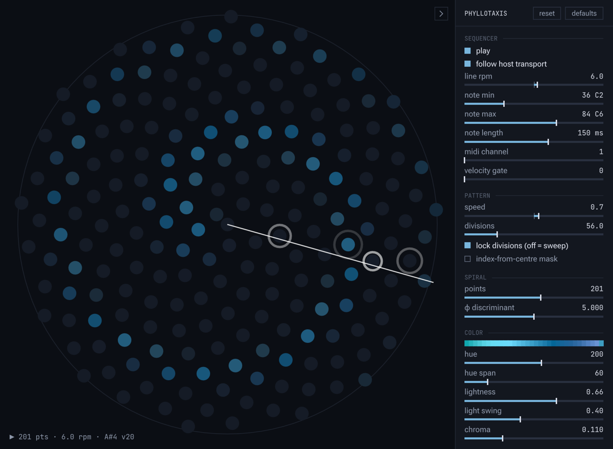

<div align="center">


</div>

<a href="#nolink"></a>

# phyllotaxis moiré sequencer

A MIDI sequencer built on the phyllotaxis pattern from sousastep.quest's background shader (`public/shaders/sousavfx-voronoi*.frag`, `public/js/vfx.js`). It draws each site as a single point instead of a voronoi cell, and colours every point exactly as the shader colours its cell. It comes in two forms: a Max 9 `v8ui` patch, and an AU / VST3 / CLAP plugin (plus a standalone app) built with [YUP](https://github.com/kunitoki/yup).

A line from the centre to the rim rotates at `rpm`. It starts pointing straight up, and positive values turn it clockwise. Each point it passes plays a MIDI note:

- **pitch:** chromatic, set by the point's distance from the centre. `noteMin` is at the centre and `noteMax` at the rim. Set min above max to flip the range.
- **velocity:** `round(127 × brightness)`, where brightness is the HSB value, `max(r, g, b)`, of the point's colour. Unlit points sit at the shader's base colour `#151b26`, so they play at about velocity 19. Raise `gate` above that to hear only the lit points.
- **length:** `duration` ms, the same for every note.

<a href="#nolink"></a>

## Files

- `phyllotaxis_moire_sequencer.maxpat`: open this one. Signal chain: v8ui → `makenote` → `noteout`. Double-click `noteout` to choose a port. The patch also has a tempo helper (rpm = bpm / beats per revolution).
- `phyllotaxis_moire_sequencer.js`: the v8ui script. Keep it next to the patch.
- `CMakeLists.txt`, `source/`: the plugin. `yup/` is a git submodule.

<a href="#nolink"></a>

## Plugin

<div align="center">



</div>

A C++ port of the v8ui script that works as a MIDI generator in a DAW. The pattern maths is ported line for line in double precision, so the points, colours and notes match the Max version. Notes are generated on the audio thread with sample-accurate timing, and every note-on gets its note-off: notes end when the transport stops, the channel changes, or the pattern is reset.

The formats are AU (registered as a MIDI processor, so Logic lists it under MIDI FX), VST3, CLAP and a standalone app. The VST3 and the standalone app have been tested in Ableton Live on macOS and Windows. The AU is macOS only.

### Building

Needs CMake 3.31+, plus Xcode's command line tools on macOS or Visual Studio 2022 (or its Build Tools) with the C++ workload on Windows.

```bash
git clone --recurse-submodules https://github.com/jbaylies/philotaxis_moire_sequencer.git
cd philotaxis_moire_sequencer
cmake -S . -B build -DCMAKE_BUILD_TYPE=Release
cmake --build build -j
```

On Windows, configure with `-G "Visual Studio 17 2022" -A x64` and build with `cmake --build build --config Release --parallel`.

The first configure downloads YUP's dependencies (SDL, the VST3, CLAP and AudioUnit SDKs). Each build installs the plugins into `~/Library/Audio/Plug-Ins` as `Phyllotaxis.vst3`, `Phyllotaxis.clap` and `phyllotaxis_au_plugin.component`. These are real copies rather than symlinks, because hosts without Desktop access, such as Ableton Live, skip links into a protected folder. The standalone app is `build/Phyllotaxis.app`.

On Windows, each build installs `Phyllotaxis.vst3` into `%LOCALAPPDATA%\Programs\Common\VST3` and `Phyllotaxis.clap` into `%LOCALAPPDATA%\Programs\Common\CLAP`. Neither folder needs administrator rights. If your host doesn't scan the per-user folder, copy the VST3 into `C:\Program Files\Common Files\VST3`. The standalone app is `build\Release\Phyllotaxis.exe`.

### Using it

- **Logic Pro:** insert it in an instrument track's MIDI FX slot.
- **Ableton Live:** put it on a MIDI track (it outputs silent audio). On a second MIDI track with an instrument, set **MIDI From** to the first track, then **Phyllotaxis**, and set **Monitor** to **In**.
- **Bitwig, Reaper, Cubase:** load the VST3 or CLAP and route its MIDI output to an instrument.

The plugin ignores incoming MIDI.

### Differences from the Max version

- `followTransport` (on by default): the line only sweeps while the host is playing. Turn it off to run freely. The standalone app has no transport, so the line always runs there.
- `channel` is a parameter. The Max version sends the channel out of a second outlet.
- **defaults** always restores `divisions` to 56. In the Max version, defaults with the lock off keeps the value the sweep was showing.
- In the panel, Shift-drag a slider for fine steps. Click the corner button to hide the panel.
- Every parameter can be automated by the host and is saved with the session, together with whether the panel is open.

<a href="#nolink"></a>

## Parameters

| section | name | range | default |
|---|---|---|---|
| sequencer | `play` | 0/1 | 1 |
| | `rpm` | −120 … 120 | 6 |
| | `noteMin` / `noteMax` | 0 … 127 | 36 / 84 |
| | `duration` (ms, log) | 1 … 4000 | 150 |
| | `channel` | 1 … 16 | 1 |
| | `gate` (min velocity) | 0 … 127 | 0 |
| | `followTransport` (plugin only) | 0/1 | 1 |
| pattern | `speed` | −10 … 10 | 0.7 |
| | `divisions` | 1 … 233 | 56 |
| | `divLock` (off = time-run sweep) | 0/1 | 1 |
| | `maskType` (index-from-centre) | 0/1 | 0 |
| spiral | `points` (log) | 2 … 9001 | 201 |
| | `discriminant` (φ = (1+√D)/2) | 1 … 9 | 5 |
| color | `hue`, `hueSpan` | 0 … 360 | 200, 60 |
| | `lightness`, `lightSwing` | 0 … 1 | 0.66, 0.4 |
| | `chroma` | 0 … 0.4 | 0.11 |

The pattern, spiral and color parameters use the same ranges, defaults and easing as the web panel. `speed`, `divisions` and `discriminant` glide to new values. Moving the divisions slider turns its lock back on.

Each parameter can be set three ways: in the panel (drag a slider, click a toggle, double-click to reset), with a message (`rpm 12`), or as an attribute. Attributes are saved with the patcher. The script also implements `getvalueof`/`setvalueof`, so `pattr` can store every value.

Other messages: `start`, `stop`, `reset` (line back to vertical, phases zeroed), `defaults`, `panel 0/1`, and `bang` (resends the MIDI channel).

If several points of the same pitch are crossed in one tick (5 ms), only the loudest plays. Each tick plays at most 32 notes.

<a href="#nolink"></a>

